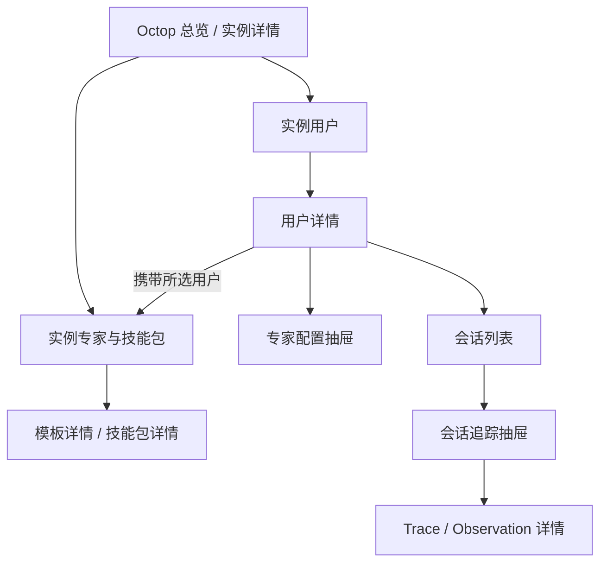

# Octop 实例功能管理 PRD 与页面 Spec

**文档版本：** V0.2，2026-11-10，Asia/Shanghai。

**状态：** 决策已评审确认；本轮交付实施规划与页面定义，未实施功能。

**所属项目：** Mayfly-Go，Octop 模块。

**规划基线：** Mayfly-Go `feature/ver1.0@ef300fa2`；本机 Octop 源码 `724e33c6`。本机源码版本不等于各实例运行版本。

**已确认的产品决定：** “当前用户”指在当前实例用户列表中选中的 **Octop 用户**，不是 Mayfly 登录账号，也不是该实例的全部用户。

本文中的页面、接口、权限码、文件和交付阶段均为拟议规格，不表示已经上线。第 14.1、14.2 节列出全部已确认决定；其余实现细节以实施阶段核验为准。

## 1. 背景、依据与现状

### 1.1 需求原文的产品化表达

1. 新增实例专家与技能包页面，列出所选 Octop 用户自己创建的专家模板和技能包；可以查看资源详情。
2. 新增实例用户页面，展示实例内用户，以及每个用户的专家创建数、会话数。
3. 从用户进入详情，查看该用户的实际专家、专家配置和会话列表；从会话进入运行追踪，读取该实例关联 Langfuse 的数据。
4. 先完成实施规划和页面 Spec，形成可评审的 Markdown PRD；本轮不修改产品代码、迁移、生产配置或运行服务。

### 1.2 已阅读的项目依据

- [Casdoor 与 Octop 管理二开交接](../casdoor/2026-11-10-casdoor-octop-handoff.md)。本轮以该文档恢复交付边界，不自动续做旧 PRD 的全部管理写入。
- [Casdoor 服务连接实施与生产验收](../casdoor/2026-11-09-service-connection-implementation.md)。Casdoor 是独立模块，本需求不改变其服务、组织或授权模型。
- [Octop 模块说明](README.md)、[逐实例兼容性清单](compatibility-checklist.md)。沿用主机、数据库资源、ACL、字段白名单和不集中存储业务正文的边界。
- 仓库 `AGENTS.md`、`docs/server/{architecture,application,infrastructure,security}.md`、`docs/frontend/{overview,component,api,i18n,style}.md`。
- 用户提供的四张截图：Langfuse 配置、运行轨迹、我的专家、技能包工作区。截图用于理解页面和业务，不作为运行版本、权限或数据完整性的核验证据；截图中的 Key 不进入本文。

### 1.3 已核对的 Mayfly 能力

- 实例登记、主机/HTTP/PostgreSQL 监控、日志元数据采集已经存在。
- `frontend/src/views/octop/instance/InstanceDetail.vue` 当前展示运维状态、指标和采集检查点，没有本需求的业务页面。
- `server/internal/octop/infra/pgcollect/reader.go` 现有读取器面向三类事件表，不是用户、专家、模板和会话的业务读取器。
- `t_octop_event` 是经过白名单处理的事件记录，不能作为完整用户目录、专家清单、会话总数或 Langfuse Trace 清单。
- `infra/octopapi/health.go` 当前只有健康检查，没有带认证的 Octop 管理 API 客户端；不能直接把 `apiUrl` 当作已具备业务读取能力。
- 现有实例可见性主要通过关联主机 ACL 检查。新业务读取还必须检查被引用数据库资源的读取授权；不能只给菜单权限就读取数据库或 Langfuse 内容。
- 交接记录曾登记 4 个实例；其中 102.104 三个实例当时未关联 PostgreSQL，99.64 实例有关联。这里是历史交接事实，本轮没有访问生产重新核验，也没有补配数据库。

### 1.4 已核对的 Octop 源码事实

以下路径位于外部本机仓库 `E:/git/octop`，核对提交为 `724e33c6`；实施前必须逐实例验证兼容性。

| 对象 | 源码位置 | 与本需求直接相关的事实 |
| --- | --- | --- |
| 用户 | `src/octop/infra/db/repos/users.py` | `users.id` 是整数身份；包含用户名、显示名、禁用状态等，也包含密码相关字段，不能整行透传。 |
| 实际专家 | `src/octop/infra/db/repos/agents.py` | `agent_id` 是公开标识；`user_id` 表示归属；`kind` 区分 `expert` / `team`；含模型、配置、挂载资源及模板引用。 |
| 用户发布的专家模板 | `src/octop/infra/db/repos/published_experts.py` | `published_expert_id` 是公开标识；`created_by` 是创建者字符串 ID；`source_agent_id` 是来源专家。 |
| 技能包 | `src/octop/infra/db/repos/skill_packages.py` | `skill_package_id` 是公开标识；`created_by`、`skill_count`、`shared`、复制/下载策略为独立字段。技能文件和条目详情还涉及包存储。 |
| 业务会话 | `src/octop/infra/db/repos/threads.py` | `thread_id`、`agent_id`、`user_id`、渠道、标题、创建及最近活跃时间存在；`last_active=0` 表示尚无对话轮次。 |
| 模板 API | `src/octop/api/routers/experts.py` | `GET /api/experts/published` 返回发布模板清单，并非“只返回当前用户创建”；详情还可能含文件正文。 |
| 技能包 API | `src/octop/api/routers/skill_packages.py` | 可见包可能包括共享/群组资源；`writable_only=true` 也不等价于创建者是所选用户。 |
| 用户/专家 API | `src/octop/api/routers/{users,agents}.py` | 存在用户清单和 `GET /api/agents?scope=all`，有源端权限要求；常规 API 使用 Octop 身份认证。 |
| 会话 API | `src/octop/api/routers/chat/history.py` | 专家下会话列表默认限制 50 条，且带用户范围检查，不能简单累加各专家前 50 条作为总数。 |
| Langfuse 配置 | `src/octop/infra/agents/settings/langfuse.py`、`src/octop/api/routers/observability.py` | Octop 存储写入端配置和加密 Secret，只回显已配置状态；没有本需求的会话追踪查询 API。追踪配置交给 `octop-harness`，这里未证明实际 `sessionId` 映射。 |

## 2. 目标、范围与使用场景

### 2.1 使用者与目标

使用者是获授权的 Mayfly 运维/业务管理员。其目标是在不进入各实例逐一查找的情况下，回答：

- 某个 Octop 用户创建了哪些可复用专家模板、哪些技能包？
- 某实例有哪些本地用户，每人当前有多少专家、多少业务会话？
- 某用户的专家使用什么模型、技能包、知识连接和运行参数？
- 某次会话发生了哪些轮次、模型调用和工具调用，问题出现在哪个节点？

### 2.2 P0 交付范围

- 两个主页面：**实例专家与技能包**、**实例用户**。
- 用户详情子页；专家配置、模板详情、技能包详情和会话追踪的只读抽屉。
- 按实例、按用户严格过滤，服务端分页及完整统计。
- 必要的接入配置表单：复用实例编辑入口，配置业务只读读取、Octop 预览 API 和 Langfuse 关联；它是依赖设置，不新增独立管理中心。
- Langfuse 多轮追踪、Observation 树/时间线、指标及受独立权限控制的按需正文查看。
- 分项能力、错误、上次读取时间、数据不完整与历史边界展示。

### 2.3 本期不交付

- 专家/模板/技能包的新增、编辑、删除、发布、安装、复制、挂载、分享、导入导出、启停或对话发送。
- Octop 用户新建、禁用、角色调整、密码重置及 Casdoor 授权变更。
- Mayfly 登录接入 Casdoor SSO，或自动将 Mayfly 账号绑定为 Octop 用户。
- 全量聊天、Prompt、工具参数/结果在 Mayfly 持久化、全文检索或批量导出。
- 改造 Octop 业务核心、升级 Langfuse、补录历史 Trace、自动打开实例追踪开关。
- 无数据依据的历史累计创建数、成本估算、用户行为评分、跨实例用户合并。

## 3. 业务对象、归属与统计口径

### 3.1 身份与隔离键

1. **操作者**：Mayfly 登录账号，决定页面动作及实例/资源访问权限。
2. **被查看用户**：`instanceId + octopUserId`，由实例用户列表选中。选择某用户仅改变查看范围，不代表登录为该用户，不赋予源端权限。
3. **资源归属**：模板/技能包以源端 `created_by` 精确匹配所选用户 ID；不能依据名称、邮箱、共享标记或可写标记判断创建者。
4. Octop 用户 ID 在 API 中统一作为字符串处理；对于源端整数 ID，只做已验证的十进制规范化，不做用户名或邮箱匹配。
5. 专家、模板、技能包、会话均使用公开字符串标识，禁止用源表自增 `id` 代替 `agent_id`、`published_expert_id`、`skill_package_id` 或 `thread_id`。
6. Casdoor 关联仅作为可选身份说明，缺少映射仍可查看本地 Octop 用户；沿用稳定 ID 及人工确认规则，不重用旧、新模块含义不同的 `connectionId`。

### 3.2 需要明确区分的三类“专家”

- **内置模板/市场条目**：Octop 预置或市场目录，不进入本期个人创建的专家模板库。
- **用户发布模板**：`published_experts` 中由所选用户发布的可复用快照，进入资源页“专家模板”。源专家变化不代表快照同步变化。
- **实际专家**：`agents` 中归属该用户且 `kind=expert` 的实例，进入用户详情“专家”；从内置、市场、用户发布模板创建的实际专家都可以计入该用户现存专家。

截图“我的专家”主要用于实际专家卡片的理解，不能据此把实际专家列表与发布模板库合并。用户创建但尚未发布成模板的专家只出现在用户详情，不虚构一条模板记录。

### 3.3 P0 指标定义

| 指标 | 口径 | 不包含/限制 |
| --- | --- | --- |
| 专家创建数 | 当前源数据中归属所选用户、`kind=expert` 的不同 `agent_id` 数量，包含停用但仍存在的专家。页面提示“当前保有的专家；按源端归属统计”。 | 不含团队、他人共享专家、已删除专家及未实例化模板。没有创建操作者历史时，不声称证明每条均由本人点击创建，也不称为历史累计。 |
| 会话数 | 当前实例中 `threads.user_id` 为该用户的不同 `thread_id` 数量，包含尚无消息的已创建会话。 | 不等于消息数、轮次数、Trace 数、登录 Session 数；不因 Langfuse 关闭、延迟或清理减少。 |
| 专家模板数 | `published_experts.created_by` 精确等于用户 ID 的现存发布模板数。 | 不含内置/市场模板和他人发布的可见模板。 |
| 技能包数 | `skill_packages.created_by` 精确等于用户 ID 的现存包数。 | 他人共享给自己的包不计入；自己创建后共享给他人的包仍计入。 |
| 技能数 | 包内当前可读取条目数；源端 `skill_count` 可作摘要并注明来源。 | 如果条目与摘要不一致，提示不一致/待刷新，不能构造缺失条目。 |

**会话归属特别规则：** 某用户使用其他用户共享的专家所产生的会话，仍按 `threads.user_id` 计入会话用户；不能通过 `agents.user_id` 内连接过滤而漏掉这些会话。该字段代表 Octop 源端归属，不推断成 IM 群聊全部参与者或逐条消息的真实员工身份。

**列表与统计一致：** 用户列表的两项计数默认是源端当前保有总数；用户详情首次打开不预设时间过滤，列表总数与该口径一致。用户主动筛选时间/渠道后，显示“筛选结果数”，不覆盖顶部总数。`0` 只表示完整读取成功后确认为零；失败、未支持、未配置分别显示状态，数值为 `null`。

## 4. 读取方案与选择依据

### 4.1 建议方案 A：PostgreSQL 元数据 + Octop 预览 API + Langfuse

- **清单、归属、统计与配置元数据**：Mayfly 后端复用实例已有数据库资源，以只读、限定字段查询 `users`、`agents`、`threads`、`published_experts`、`skill_packages`。
- **文件/技能条目预览**：由后端调用经过验证的 Octop 只读 API，获取包内技能清单、模板文件目录及允许查看的文件；不把主机目录扫描作为隐式备用协议。
- **会话运行追踪**：后端使用绑定项目的 Langfuse Public API；浏览器只访问 Mayfly API。
- 优点：元数据总数不受 Octop 当前列表默认条数影响；复用既有数据库资源；业务清单与追踪故障可分开。
- 代价：需要按实例核验数据库 schema、只读权限以及 Octop API 认证；不能把本机源码字段当作全部部署事实。

本方案已经评审确认为主方案（第 14.1 节）；方案 B 仅作为单实例降级路径。P0 的技能条目和文件预览依赖 Octop API，必须在阶段 S0 验证可行；如果缺少可用读取身份或相关接口，保留为明确未交付项，不能仅展示 `skill_count` 就宣告完整页面已交付。

### 4.2 备选方案 B：Octop 管理 API 为主 + Langfuse

- 尽量通过原生用户、专家、模板、技能包和会话 API 查询，避免直接适配数据库 schema。
- 优点：文件预览与源端权限语义接近原生产品，更适合以后具备完整管理读取协议的部署。
- 当前限制：会话完整分页/统计、跨用户读取、最小权限机器认证尚未逐实例证明；某些列表默认 50 条，某些 `as_user` 分支要求管理员，不能假设一个普通读取账号可跨用户访问。
- 若要新增 Octop 服务端管理读取契约，属于跨仓库新增范围，应先补充设计；本 PRD 不授权直接修改 Octop 核心。

不采用“从现有日志推算全部数据”方案，因为它会漏掉没有日志的用户/专家/会话，且日志留存与业务对象留存不同。

### 4.3 连接、凭据与源端授权

- PostgreSQL 沿用 Mayfly 数据库资源及隧道/网络配置；不新存第二份数据库密码，不默认 `127.0.0.1` 指 Mayfly 所在容器。
- Octop 预览 API 的凭据独立于 Casdoor 管理身份。阶段 S0 验证部署版实际支持的认证、有效期、失效表现和只读权限；不得把 Casdoor 的 `client_credentials` 套用到 Octop，也不默认长期粘贴浏览器 Cookie/JWT 是稳定接入方式。
- 只使用管理员明确配置的既有读取身份。是否需要新增源端身份、如何支持到期重取，是实施前依赖项，不在本轮创建或扩大权限。
- Mayfly 的 Langfuse 读取连接独立登记 `host + projectId + 读取凭据`，绑定到实例。优先独立读取身份；若部署版无法提供真正只读 Key，应注明凭据的实际能力，并由适配器固定只开放查询路径。
- 不解密/复制 Octop 数据库 `secrets` 表中的 Langfuse Secret；Octop“已启用上报”与 Mayfly“可以读取”是两个独立状态。
- 凭据只在后端按现有加密机制保存，GET 仅返回已配置、更新时间和验证状态；编辑留空保留，清除必须显式操作。Public Key 如需回显按掩码展示，Secret、认证头和 Cookie 均不回传。

## 5. 实施规划（待 PRD 通过后执行）

顺序：`S0 → S1 → S2 / S3 → S4 → S5`。S2、S3在接口契约稳定后可分别交付；不得因为完成菜单或 DTO 就跳过真实源端验证。本轮不执行这些阶段。

已确认允许分片发布：S0+S1 完成后 S2 可独立发布，S3、S4 各自完成后独立发布；未发布切片的入口不上菜单，迁移按切片最小追加到发布时 `Version` 对应的批次文件（第 14.2 节）。

### S0：逐实例协议与数据契约核验

- [ ] 核对实例、实际数据库资源、Octop 运行版本/schema、需要读取的表列、公开标识、创建者编码、团队标记及时间格式。
- [ ] 验证只读数据库身份的限定 SELECT、分页、全量计数、超时与所需权限，不修改源表和生产索引。
- [ ] 验证模板/包详情与技能条目 API、源端身份认证与到期机制；用两名创建者验证“可见/可写”与“本人创建”不同。
- [ ] 核对 Langfuse 运行版本、项目、读取协议、留存、数据延迟、`thread_id ↔ sessionId`、用户及实例区分标记；用脱敏样例核对一条多轮会话。
- [ ] 记录每实例能力，不把一台验证结果外推其他实例。暂不能核验的实例保持“未验证”。

**出口：** 脱敏的兼容性记录、字段/标识映射、真实可用的认证方案和会话关联证据。若核心数据缺字段或无读取身份，明确受阻能力与补充方案，再推进对应功能；不静默缩减 P0。

### S1：后端读取边界、配置及能力状态

- [ ] 增加业务读取契约和适配器；接入实例/数据库 ACL、动作权限、上下文校验、分页、超时与字段投影。
- [ ] 增加 Langfuse/Octop 读取连接的加密配置、验证和实例绑定；复用实例编辑表单入口。
- [ ] 提供逐功能 `capabilities`、连接状态和来源时间；测试未登录、无权限、跨实例 ID、失效凭据及配置并发更新。

**出口：** 基础 API 能表达成功、未配置、不支持、无权、失败及部分可用；接口不泄露凭据，也不写 Octop/Langfuse 业务数据。

### S2：实例用户与用户详情

- [ ] 实现用户清单、完整专家/会话计数、专家清单、专家配置和会话清单。
- [ ] 实现用户页、用户详情、筛选回退和深链接；覆盖共享专家会话、零资源用户、禁用用户、团队与删除对象。
- [ ] 验证同一读取时点下总数与未筛选详情一致，避免 JOIN 放大计数、按专家数发起 N+1 请求或截断统计。

**出口：** 不依赖 Langfuse 成功即可完整查看本地业务清单和计数；按第 3 节口径验收。

### S3：所选用户的专家模板与技能包

- [ ] 实现创建者限定的资源列表、模板详情、技能包/技能条目详情及只读文件预览。
- [ ] 实现双 Tab 资源页及从用户详情跳转；所有详情再次验证创建者和实例归属。
- [ ] 覆盖内置、市场、他人共享、自建后共享、来源专家删除、空包及文件预览不可用。

**出口：** 所有列表、总数、详情都限定所选用户；技能条目真实可读，未通过核心预览依赖时不得标记该能力完成。

### S4：会话与 Langfuse 追踪

- [ ] 实现已验证的会话关联、项目/实例过滤、版本适配和分页完整性。
- [ ] 实现多轮 Trace 列表、Observation 树/时间线、指标与受控内容详情；无正文权限仍可看获准元数据。
- [ ] 覆盖延迟、部分上传、历史清理、共享项目同名用户/同号会话、错误过滤、孤立节点及上游超时。

**出口：** 可以从实例用户一路定位到具体会话和调用节点；关联无法证明时不给出错误用户的数据，也不伪造“零追踪”。

### S5：集成验收与发布准备

- [ ] 完成第 12 节场景和第 13 节检查；核对中英文、权限、菜单迁移、路由、深链接、主题和上下文切换。
- [ ] 在隔离环境完成业务源只读证明和真实链路验收，再进行经授权的逐实例生产只读验收。
- [ ] 提交完成/未完成清单、兼容矩阵、回退步骤与截图证据；发布审批和生产部署另按届时授权执行。

**出口：** 达到 P0 的真实功能验收。暂不具备接入条件的实例可以标注不可用，但不能作为“该实例业务数据为空”验收通过。

## 6. 信息架构与公共页面规则

### 6.1 页面与入口



- 保留运维实例详情的用途，增加“用户”“专家与技能包”入口，不把全部业务内容塞入指标页面。
- 新增两个菜单项，位于 Octop 分组下；用户详情为隐式详情路由，不作为第三个主菜单。
- 拟议组件键：`OctopInstanceLibrary`、`OctopInstanceUsers`、`OctopInstanceUserDetail`，与后端菜单 `meta.routeName` 一致。
- 拟议相对菜单路径：`octop-library`、`octop-users`、`octop-user-detail`；完整路径遵循现有 `/octop` 菜单解析，实施时验证隐藏详情路由的注册方式。
- 业务新页统一 URL 上下文 `instanceId`、`userId`；用户详情可带 `tab=experts|sessions`，会话可带 `threadId`。不复用旧运维页 `id` 为用户 ID。
- 从总览进入“实例用户”携带实例；用户行“详情”携带实例/用户；“专家与技能包”携带用户并保持资源 Tab。浏览器返回恢复列表页码、筛选和滚动位置。

### 6.2 公共区和上下文

1. 页头：页面名、实例选择器、实例地址摘要、刷新。
2. 数据来源状态条：业务读取状态和读取时间；涉及预览/Langfuse 时单独显示各来源状态。
3. 当前用户身份：显示名、用户名、Octop 用户 ID；任何用户名重名均可辨认。
4. 页内内容、筛选和分页。

- 实例选项仅来自服务端授权范围。无上下文时可以选择第一条有权实例；URL 显式指定了无效/无权实例时显示错误，不切换到其他实例伪装成功。
- 从用户列表或详情进入资源页时直接使用该用户。直接打开资源页且无 `userId` 时，显示“请选择实例用户”，不默认管理员、不查询全用户资源。
- 切换实例立即清空用户、选择项、详情、分页和旧响应；切换用户同样清空资源/追踪。请求取消或使用上下文序号阻止旧响应覆盖新页面。
- 服务端在每条业务请求中重新检查登录、动作权限、实例/数据库权限，以及用户/专家/会话/追踪的父子关系；不依赖前端筛选。
- 缓存键必须含实例、用户、权限上下文和连接配置版本；退出、权限失效、切换配置后清空。不把可见 A 实例的缓存返回 B 实例。

### 6.3 统一列表和表现

- 复用 `DataTable`、既有抽屉与声明式 `AutoForm` 系列；新配置表单不手写成片 `el-form-item`。
- 页面缺省每页 10 条，可选 10/20/50/100，后端上限 100；筛选变化回第一页。
- 列表默认按源端更新时间倒序、公开 ID 稳定排序；用户列表默认创建时间倒序、用户 ID 稳定排序。没有更新时间则明确改用创建时间。
- 日期接口使用带时区的 RFC3339/ISO8601，前端沿用系统时区，验收使用 Asia/Shanghai。时间区间统一 `[start, end)`。
- 名称长值省略并支持展开；实体名称保留源值，界面文案、枚举、错误与帮助均走中英文 i18n。
- 支持现有明暗主题；1440px 下主区完整，1024px 下筛选换行，窄屏抽屉铺满、表格局部横向滚动，使用 Flexbox。
- 不展示没有真实来源的卡片数值，不用模拟数据填补生产空白。

## 7. 页面 Spec

### P-LIB：实例专家与技能包

**目的：** 查看所选用户创建的复用资源；不混入“所有可见资源”。

```text
实例专家与技能包       [实例选择] [刷新]
来源/读取时间         当前用户：显示名 · 用户名 · ID [选择用户]
[专家模板 (N)] [技能包 (M)]
[名称 / ID 搜索] [查询] [重置]
资源列表或卡片                                  [分页]
```

#### 专家模板 Tab

- 默认表格，允许切换卡片；两种视图使用相同服务端结果、过滤和分页。
- 字段：名称/头像、模板公开 ID/slug、描述摘要、创建者、来源专家 ID、创建时间、更新时间、详情。
- 强制条件：当前实例 + `created_by == 所选用户ID`。数量为该创建者的完整总数，搜索后单独显示筛选数量。
- 详情展示模板元数据、来源专家链接（仍存在且可访问时）、快照更新时间、文件目录，以及获准的按需文件预览。
- 来源专家已删除或不可访问时，只将引用标为不可用；模板仍存在时继续显示模板。
- 不提供发布、安装、删除、编辑或“立即对话”；不使用专家运行开关表达模板状态。

#### 技能包 Tab

- 左侧包清单，右侧当前包的技能工作区；参照截图的包→技能层级。包清单独立分页，所选包不在当前结果时清空右侧。
- 包字段：名称/图标、公开 ID、描述、创建者、技能数、共享/群组可见范围、复制/下载策略、更新时间。
- 右侧技能支持卡片/表格；字段：技能名、slug、描述摘要、详情。技能本身有独立分页/游标，不能只取前 100 条。
- 技能详情：来源包、基础信息、允许查看的文件目录与 `SKILL.md` 预览；文件内容读取受内容权限约束，禁止脚本执行和任意路径读取。
- 自己创建后共享的包仍显示；他人共享给自己的包不显示。包中来源于市场的技能不改变该包创建者，仍可显示并标注来源。
- 不提供创建、市场安装、导入、导出 ZIP、删除和挂载。

**关键状态：** 未选用户、本人未创建模板/包、搜索无结果、用户已删除、包为空、来源缺能力、技能清单读取失败、文件不可预览分别呈现。未选择用户不请求资源 API；单个包预览失败不清空其他包。

### P-USERS：实例用户

**目的：** 显示该实例真实本地用户及资源规模，包括没有业务活动的用户。

```text
实例用户                              [实例选择] [刷新]
业务读取状态 · 读取时间
[用户名/显示名/ID] [启用状态] [查询] [重置]
用户 | 用户ID | 状态 | 专家创建数 | 会话数 | 创建时间 | 操作
...                                                    [分页]
```

- 数据来自 Octop `users`，包含启用、禁用、零专家、零会话用户；不以 Casdoor 组织目录代替，不以日志出现过的用户代替。
- 行字段：显示名/用户名、Octop 用户 ID、源端角色摘要、启用/禁用/未知、专家创建数、会话数、创建时间。
- 可选最近活跃时间来自该用户业务会话 `MAX(last_active)`；没有活动显示“暂无会话活动”，不推断在线/离线或最近登录。
- 操作：“详情”“专家与技能包”；专家计数链接到详情专家 Tab，会话计数链接到会话 Tab。
- 专家数与会话数按第 3 节解释，列头提供统计帮助。某项统计失败时仅该项显示不可用；源用户清单失败时不能显示用户总数为 0。
- 有限的源角色摘要只作信息；不等价于 Mayfly 权限或 Casdoor 访问许可。

### P-USER：实例用户详情

**目的：** 将选中用户的归属、专家和会话串联起来。

```text
实例用户 > 用户详情                   [返回用户列表] [刷新]
实例 / 显示名 / 用户名 / Octop用户ID / 状态
专家创建数  会话数  专家模板数  技能包数
[专家] [会话]
当前 Tab 的查询区与分页列表
```

- 页头提供“查看该用户专家与技能包”；没有对应动作权限时不展示其计数/入口，API 也不返回越权数据。
- 不同计数附来源时间；同一业务读取可共享一个只读快照，Langfuse 的时间单独呈现，不拼成一个虚假的同步时间。
- 用户不存在时显示“源端用户已不存在/不可读取”；不能复用上一个用户详情。已有历史事件仍属于日志模块，不由此删除。

#### 专家 Tab

- 按该用户 `agents.user_id` 和 `kind=expert` 查询；不列他人共享专家和团队。
- 字段：专家名/公开 ID、描述、模型、启用状态、最近运行状态、来源模板、挂载技能包数、创建/更新时间、配置。
- 专家启用状态与运行状态分列；数据库 `last_state` 只显示“最近记录状态”，没有实时探测不能称“正在运行”。
- 筛选：名称/ID、模型、启用状态；默认按创建时间倒序。
- 进入 P-EXPERT 配置抽屉。返回时保持用户和列表筛选。

#### 会话 Tab

- 查询 `threads.user_id`，包括用户使用共享专家的会话；筛选专家时，选项来自其会话中的专家，不限于本人拥有的专家。
- 字段：标题（空时显示“未命名会话”）、`thread_id`、参与专家摘要/ID、渠道、创建时间、最近活跃时间、有无轮次、追踪操作。
- 空会话显示“尚无消息”，最近活跃显示空状态；不把创建时间冒充真实活跃时间。
- 筛选：标题/会话 ID、专家、渠道、创建或最近活跃时间区间；明确当前筛选时间字段。
- 专家已删除时保留会话 ID 和源端保留的引用，不通过内连接丢掉记录。
- 列表不逐行同步查询 Langfuse。使用本次已取得的追踪状态或显示“查看追踪”；未查过不能显示“无追踪”。点击后按需加载。
- 点击会话进入 P-TRACE；会话总数仍由 Octop 提供，Langfuse 出错不阻止本页显示。

### P-EXPERT：专家配置抽屉

**目的：** 只读理解某个实际专家的当前配置，不触发启动、重载或修改。

- 标识：实例、所属用户、专家名称/ID、来源内置模板/发布模板、创建/更新时间。
- 基础配置：描述、模型引用、Provider 名称/ID、启用状态、最近记录状态。
- 运行参数：已验证的 `temperature`、`top_p`、`max_tokens`、最大迭代数、输入长度、轨迹开关等；源端未提供则标“不支持/未取得”，不能填入假定默认值。
- 挂载关系：技能包、知识库、MCP 连接、子专家等经过验证的 ID/名称摘要；引用不存在显示引用失效，不扩展为其他模块的修改入口。
- Prompt/人格/规则等内容仅在独立内容权限和源端能力均满足时，由用户主动展开，实时读取、脱敏、限量返回；默认不批量加载。
- 不透传 `config_json`、Provider、MCP 或存储后端的任意配置；只投影已审查字段。密码、Token、认证 Header、Cookie、连接串等永久排除。
- “源端未配置”“本版本不支持”“读取失败”“内容受限”分别显示。数据库记录配置与源端实际加载配置不能无证据宣称相同。

### P-TRACE：会话运行追踪

**目的：** 对照截图的运行轨迹体验，展示会话多轮执行、模型与工具调用和必要诊断。

```text
会话运行追踪        实例 / 用户 / 会话ID / 关联状态 [刷新] [关闭]
来源：Langfuse项目 / 查询区间 / 读取时间 / 完整性
轮次/Trace 列表      当前 Trace 时间线                 节点详情
T1 ...              ROOT → GENERATION → TOOL           概要/输入/输出
T2 ...              ...                               耗时/Token/错误
```

#### 层级与导航

1. Octop `thread_id` 是业务会话；一条业务会话可以对应 Langfuse 多个 Trace。
2. 轮次分组优先采用已核验的 turn 标识；没有 turn 字段时按 Trace 展示，不虚构“每条 Trace 恰好是一轮”。
3. Trace 内展示 Observation 的父子关系，包括模型、工具、检索、Agent/Span 等源端支持类型；类型未知保留原值。
4. 左侧按开始时间升序并提供分页/继续加载；标明已加载范围，不用固定前 N 条代表全部历史。
5. 中间提供树形列表与相对耗时时间线；右侧单击节点看概要，按需展开输入/输出。1024px 以下详情切为抽屉内 Tab。

#### 筛选、指标与内容

- 筛选：时间、Trace ID、节点类型、错误；搜索仅覆盖已取得的名称/ID/工具名，不默认全文搜索用户消息。
- 指标：起止时间、墙钟耗时、输入/输出 Token、模型、工具名、错误级别；成本仅源端提供金额与币种时展示。
- 墙钟耗时以起止时间计算，不累加嵌套 Span 形成总耗时；Token/成本只对已验证可累加的调用级记录去重聚合，不重复计入父子汇总。
- 未完整加载时只标“已加载部分合计”；未返回 Token、成本或耗时显示未知，不填 0。
- 有 `octop:content:read` 权限时，可主动查看脱敏后的模型输入/输出、工具参数/结果与错误详情；这些内容只短暂经过后端内存和当前前端视图，不进入事件表、审计正文、日志、持久缓存或导出。
- 默认每个内容字段最多 32 KiB，单次内容响应最多 256 KiB，超限显示“已截断”；不自动继续拉取全文。二进制/附件只显示安全元数据，未知结构默认不展开。
- 没有内容权限时，内容 API 拒绝请求，不能只在前端折叠后仍下发正文。复制和局部搜索也遵循相同边界。
- 可提供“在 Langfuse 中打开”辅助入口，使用服务端生成的允许域名链接；不在 URL 中带密钥，不创建公共分享，也不替代 Mayfly 内的追踪展示。

#### 完整性和故障状态

| 状态 | 页面表现 | 行为 |
| --- | --- | --- |
| 未配置读取连接 | 说明 Octop 上报与 Mayfly 读取连接独立 | 有配置权限显示接入配置入口。 |
| 源端明确未启用上报 | 显示来源与核验时间 | 不自动启用，不保证补历史。 |
| 未验证关联 | 说明无法证明会话与项目/实例关系 | 不展示可能属于他人的数据。 |
| 查询成功但暂未发现 | 显示查询范围、读取时间及可能的上报延迟 | 可手动刷新，不宣布从未有过追踪。 |
| 已知历史已清理 | 只在有留存/源端证据时显示 | 不把任意空结果解释成已清理。 |
| 部分可用/分页未结束 | 展示已取得片段并标注未完整 | 允许继续加载和重试，指标不冒充全部。 |
| 认证/权限失败、超时、限流 | 显示分项错误与可重试状态 | 不清空用户/会话列表，不回退到跨项目查询。 |
| 原始父节点缺失 | 节点放入“父节点未取得”分组 | 保留源 ID；防止循环引用卡死。 |

## 8. Langfuse 关联与版本契约

### 8.1 关联必须有证据

- 读取前先验证当前 `instanceId + userId + threadId` 属于业务源，再解析其 Langfuse 查询条件。
- 优先使用经过实际样例验证的稳定映射：`projectId + 实例区分标记 + sessionId/threadId + userId`。`sessionId=thread_id` 只是候选映射，不能在核验前写死。
- Octop 内部登录 `sessions`、渠道 `session_key`、业务 `thread_id`、Langfuse `sessionId` 属于不同命名空间，不凭名称相似互换。
- 一实例独占项目时，记录并验证该独占绑定；多个实例共用项目时，必须有可验证的实例过滤条件或等价的唯一映射证据。只有用户名、时间接近或模型相同不能证明归属。
- 对共用项目的旧记录，如缺少实例标记且无法证明唯一归属，返回 `association_unverified`；不降级为项目全量数据。若可通过明确 Trace 引用证明历史关联，记录映射版本和证据，不凭推测匹配。
- 请求中的用户/会话/实例条件由服务端生成。即使上游过滤错误或忽略参数，也必须对返回行复核稳定标识；出现越界数据时拒绝该批次并标记协议异常，不能把混合结果直接展示。

### 8.2 版本适配

Langfuse 官方将 Session 用于聚合多条 Trace；其自托管主版本之间的读取 API 存在差异。本文查询了官方 [Sessions](https://langfuse.com/docs/observability/features/sessions)、[Public API](https://langfuse.com/docs/api-and-data-platform/features/public-api) 和 [Versions & Compatibility](https://langfuse.com/docs/compatibility) 文档，核对日期为 2026-11-10。现场实际版本仍未核验。

- 自托管 v3 与 v4 分开适配；v4 的读取围绕 Observations API v2，不能为所有部署写死旧 `/traces`、`/sessions`。
- 官方对 Cloud 的旧 API 移除日期不能直接套用到当前自托管实例；按运行版本与实测接口确定能力。参见 [官方迁移映射](https://langfuse.com/faq/all/deprecated-api-migration)。
- 可用时读取部署端 OpenAPI/版本信息并固定兼容契约；不可用时记录管理员版本说明及实际读取探针证据，不能根据页面外观判断。
- 新版游标分页仅在源端明确结束后标记完整；短页或空页带后续游标时继续。旧版按其分页契约验证总数与终止，不复用 Casdoor 的分页规则。
- 所有查询限定项目、会话映射和明确时间区间。首次查看用业务会话创建时间至本次查询时点；长会话分窗分页，UI 显示覆盖范围，不能悄悄只看最近 7 天。
- 不因缺少新接口而把认证/权限错误吞成旧版回退；只在已验证的不支持场景选择对应适配器。实施时重新核对官方协议及现场版本。
- 已确认：只实现 S0 探明的实际部署版本适配；未部署版本保留契约扩展点并明确报 `unsupported`，不预先实现未经环境验证的适配代码。

## 9. 拟议后端 API 与响应契约

以下是 **Mayfly 新增 API 草案**，不是已经存在的 Octop/Langfuse 接口。统一前缀 `/api/octop/instances/:instanceId/business`，前端仍经现有 `Api` 封装调用。

| 方法与相对路径 | 用途 | 主要权限 |
| --- | --- | --- |
| `GET /capabilities` | 当前操作者可用功能、来源配置/验证状态 | 按拥有的业务动作权限裁剪。 |
| `GET /user-options` | 用户选择器的最小身份分页 | `octop:library:base` 或 `octop:user:base` |
| `GET /users` | 用户分页及获准的两项统计 | `octop:user:base` |
| `GET /users/:userId` | 用户详情及获准摘要 | `octop:user:base` |
| `GET /users/:userId/expert-templates` | 本人发布模板分页 | `octop:library:base` |
| `GET /users/:userId/expert-templates/:templateId` | 模板元数据/文件目录 | `octop:library:base` |
| `GET /users/:userId/skill-packages` | 本人创建包分页 | `octop:library:base` |
| `GET /users/:userId/skill-packages/:packageId` | 包元数据 | `octop:library:base` |
| `GET /users/:userId/skill-packages/:packageId/skills` | 包内技能分页 | `octop:library:base` |
| `GET /users/:userId/skill-packages/:packageId/skills/:slug` | 技能元数据/文件目录 | `octop:library:base` |
| `GET /users/:userId/experts` | 实际专家分页 | `octop:expert:read` |
| `GET /users/:userId/experts/:expertId` | 专家配置白名单投影 | `octop:expert:read` |
| `GET /users/:userId/threads` | 会话分页 | `octop:session:base` |
| `GET /users/:userId/threads/:threadId` | 会话元数据、追踪关联状态 | `octop:session:base` |
| `GET /users/:userId/threads/:threadId/traces` | Trace/轮次分页 | `octop:trace:base` + 会话读取 |
| `GET /users/:userId/threads/:threadId/traces/:traceId/observations` | 指定 Trace 的节点分页 | `octop:trace:base` + 会话读取 |
| `GET /users/:userId/threads/:threadId/traces/:traceId/observations/:observationId/content` | 脱敏节点输入/输出 | Trace、会话读取 + `octop:content:read` |
| `GET /read-connection` | 脱敏接入设置 | `octop:integration:save` |
| `POST /read-connection/test` | 只读验证配置，不保存 | `octop:integration:save` |
| `POST /read-connection` | 保存 Mayfly 侧读取配置 | `octop:integration:save` |

- 模板文件、技能文件和专家 Prompt 的 `/content` 读取路径与其元数据父路径对应；必须另要求 `octop:content:read`，参数仅能引用服务器返回的安全文件条目 ID，不能传任意主机路径。
- 资源页“选择用户”使用 `/user-options`，返回 `id/username/displayName` 和正常分页信息，支持名称/ID 搜索；不返回专家/会话计数、角色和其他无关字段。只有库权限时不强制额外授予全用户详情权限，不能借该入口调用 `/users` 获取完整投影。
- `/users` 两项基础计数由用户页权限允许；专家配置、会话列表、库详情及 Trace 内容仍分别受独立权限约束，不能因看到计数而读取内容。
- 普通分页沿用 `PageResult` 的 `list/total` 与实际生效的 `pageNum/pageSize`；本模块单独限制上限 100，不修改公共 `model.PageParam` 的全局默认和上限。源端游标以不透明 `nextCursor/hasMore` 单独表达，不伪造总数。
- 每个来源返回 `source`、`readAt`、`lastSuccessAt`、`state`、`complete`、`coverageStart` 等实际可知元数据；不适用字段为空。
- 统计值建议统一 `{ value: number | null, state, asOf, definition }`，避免只凭前端 `value || 0` 掩盖失败。
- 源功能状态统一 `ready / not_configured / not_verified / unsupported / forbidden / failed / partial`；追踪另有 `association_unverified / not_found_in_range`，不混同业务成功空列表。
- 未登录/动作或资源无权为请求级拒绝；部分来源失败可在成功信封中带分项错误。不得将外部原始错误、请求地址中的密钥或完整 SQL 拼入响应。
- 不新增任何 Octop 或 Langfuse 的业务写入接口；仅 Mayfly 读取连接配置允许本地保存。

## 10. 数据读取、权限和存储约束

### 10.1 读取和性能

- 为业务清单建立独立读取适配器，不扩大原事件采集器的职责，不修改旧游标来“同步用户”。
- 表/列名与排序项来自受控版本映射，用户值参数化；明确选择列，禁止 `SELECT *` 读取用户/专家全记录。配置 JSON 在源查询或受控投影中只提取白名单字段。
- 对一个用户页批量取得两项统计；使用分别分组再关联或等价方式，避免专家×会话 JOIN 倍增。用户、统计尽量在同一只读快照取得，不锁写表。
- 业务查询默认 10 秒超时，单次 Langfuse/API 请求默认 15 秒；查询可取消，重试有上限并遵循限流等待，不无限重试，不阻塞其他实例。
- 元数据可有最多 30 秒内存缓存，显示 `asOf`；刷新绕过该缓存。业务内容不缓存；连接/权限变化立即使相关缓存失效。
- 验收容量（已确认定位为基线测量目标，非硬性发布阻断）：单实例 1,000 用户、10,000 专家、100,000 会话；受控网络和已知索引下用户/会话列表 p95 ≤ 3 秒、追踪首批 p95 ≤ 5 秒。S0 记录源端计划和网络基线；实测超标一个数量级内如实披露并随发布说明给出，超一个数量级回评审判定是否阻断；不悄悄改指标或给生产加索引。
- 只查询当前实例/用户/会话需要的数据，不把项目全量 Trace 拉入 Mayfly 再在前端筛选。必要分页先在上游限定范围，再逐行复核。

### 10.2 权限组合

- 已确认新增 7 个权限码：`octop:library:base`、`octop:user:base`、`octop:expert:read`、`octop:session:base`、`octop:trace:base`、`octop:content:read`、`octop:integration:save`。现有日志权限不自动获得新业务内容权限。
- 每次请求均需登录、动作权限和实例主机 ACL；查询 PostgreSQL 还需关联数据库资源的有效读取 ACL；源 API 还受配置的读取身份原生权限限制。
- 业务管理员可看被授权实例中选择的用户，这来自 Mayfly 动作/实例范围，不代表给该用户新增 Casdoor 登录许可。
- `octop:content:read` 不是单独的全局内容通行证，必须与对应库/专家/会话/Trace 权限和父链范围共同满足。
- 接入配置保存需实例配置权限及有效资源授权；绑定/替换共享项目、修改实例过滤规则时重新验证，旧验证结果不得覆盖新凭据版本。
- 防止通过修改 URL 中的用户/模板/包/专家/会话/Trace/Observation ID 越权；共享资源引用不自动扩大个人库或配置正文的读取范围。
- 业务读取 HTTP 客户端只访问已保存、验证的 Octop/Langfuse 地址；允许企业已登记内网地址，限制跨主机重定向，启用正常 TLS 校验，不随业务请求接收任意目标 URL。接入测试允许有接入配置及实例配置权限的操作者输入候选地址，但必须先通过同一地址/端口校验并限定探测路径，不能作为任意 HTTP 代理。

### 10.3 内容与审计

- 保留原边界：Mayfly 事件库、快照表、持久缓存、日志、备份不存聊天全文、Prompt、工具输入输出或 Secret。
- 新页面可在有权限时按需瞬时读取正文；这与新增全文采集不同。内容响应标记 `Cache-Control: no-store`，前端不放 localStorage、持久 Pinia、URL 或离页保留缓存。
- 元数据也可能含秘密：描述、标题、错误、工具名和配置字符串按字段白名单及脱敏策略输出，不直接复用外部自由文本当审计消息。
- 正文预览默认纯文本/安全 Markdown；禁止执行脚本、加载外部资源和跟随任意文件 URL。工具参数/结果中的凭据和未知敏感字段遮盖，未知格式标“内容受限”。
- 审计记录操作者、实例/用户/对象稳定 ID、动作、来源状态、时间、结果和脱敏错误码；内容查看单独记访问事件，不记录正文、搜索词全文、连接密钥或响应包。
- 不改原 `redaction` 规则以允许 Prompt/工具正文进入 `t_octop_event`；预览使用独立投影契约与敏感数据测试。

### 10.4 Mayfly 存储和迁移

- 业务清单和计数 P0 按需读取，不默认新建整套用户/会话/Prompt 镜像表。
- 新增读取连接/项目绑定/验证状态确需持久化时，使用 Octop 模块内独立实体和仓储；数据库资源仍只存引用，凭据字段加密。具体表结构在 S1 根据已验证认证方案固定。
- 数据库迁移唯一版本真源是 `server/internal/pkg/config/app.go`。本轮读取为 `Version = "v1.12.3"`；若实施时未变，新增菜单、权限和连接配置迁移追加到 `server/migration/migrations/v1_12/v1_12_3.go`，ID 前缀 `v1.12.3-`。
- 实施时必须重新读取 `Version`；不因本文日期或功能名称新开版本目录/批次，不改已发布迁移的 ID/顺序。每条新增迁移按 ID/code/列检查幂等。
- 不删除旧 `t_octop_casdoor_*` 或独立 Casdoor 表，不机械迁移旧身份引用；本需求不修改 `pkg/`、`common/` 公共接口。若后续发现必须修改，先提供具体差异并按 AGENTS 询问。

## 11. 拟改动区域与验证归属

以下为实施定位，不在本轮创建产品文件；最终命名可在阶段 S1 固定，不能把下列拟建文件当作现有能力。

| 区域 | 拟议文件/入口 | 职责与验收归属 |
| --- | --- | --- |
| Octop HTTP | 新增 `server/internal/octop/api/business.go`、`api/read_connection.go`，补充 `api/form/` | 参数、动作权限、响应投影；覆盖父链越权和敏感字段不回传。 |
| 应用编排 | 新增 `application/business.go`、`application/trace.go`、`application/read_connection.go`、相关 DTO | 用户范围、指标口径、多源失败、关联规则；完整返回 error。 |
| 领域契约 | `domain/` 下增加业务读取/追踪接口和状态类型 | 上层依赖契约，保持 api → application → domain/infra 分层及 IOC 装配。 |
| PostgreSQL | 新增 `infra/businessread/` | schema 适配、只读分页、计数、字段白名单；不复用事件增量游标。 |
| 外部 API | 扩展 `infra/octopapi/`、新增 `infra/langfuse/` | 经过验证的认证、固定只读路径、版本与分页、返回范围复核。 |
| 配置持久化 | `domain/entity/`、`domain/repository/`、`infra/persistence/`、`init/init.go` | 加密配置、revision/验证状态、真实路由及依赖注册。 |
| 页面与上下文 | 新增 `frontend/src/views/octop/library/InstanceLibrary.vue`、`user/InstanceUsers.vue`、`user/InstanceUserDetail.vue`、页内抽屉和上下文 | 按用户切换、列表、预览、追踪；覆盖晚响应、返回与深链接。 |
| 前端接线 | 现有 `api.ts`、`types.ts`、`route.ts`、实例页入口、实例编辑表单 | Api 封装、类型、组件键、读取配置；避免直接 axios。 |
| 国际化和菜单 | 中英文 `octop.ts`/`menu.ts`，当前版本迁移批次 | 文案、菜单、独立动作权限；不能只加菜单未注册后端。 |

## 12. 验收场景

### 12.1 个人库和用户目录

- **AC-01 用户范围：** 同实例 A/B 各建模板、包；选 A 后列表、总数、详情和文件预览只出现 A 创建的资源。修改 ID 访问 B 资源被拒绝。
- **AC-02 共享语义：** B 共享给 A 的包不出现在 A 的创建库；A 自建后共享的包仍在 A 库中，标注可见范围。
- **AC-03 模板语义：** 内置/市场模板不进入创建库；A 从内置模板创建的实际专家进入专家清单，只有发布后才有 A 的模板条目。
- **AC-04 用户完整性：** 零专家/零会话、禁用用户仍在源用户清单；没有 Casdoor 关联也能查看。源端用户无记录与源读取失败区别明确。
- **AC-05 计数：** 专家与会话分别为 2、3 的用户显示 2/3，不因 JOIN 变成 6/6；团队、已删除专家和他人共享专家按第 3 节处理。
- **AC-06 会话归属：** A 使用 B 的共享专家产生一条会话，该会话计入 A；B 不因拥有专家而取得该会话的用户归属。
- **AC-07 分页完整：** 用户拥有 137 个会话、105 个模板或某包拥有超过 100 个技能时，总数准确且能逐页查看末页，不截断为 50/100。
- **AC-08 空与错：** 模板/包成功读取 0 条才显示未创建；缺表、无授权、未配置、API 失效和读取超时各有对应状态，不显示假零。

### 12.2 专家和会话详情

- **AC-09 配置准确：** 展示已取得的模型/参数/技能包/知识库/MCP 引用；未知字段不填默认值，源端配置与最近运行状态标识清楚。
- **AC-10 无写入：** 打开页面、刷新、查看配置/技能/Trace 不触发专家启动、会话发送、源端配置保存或上游业务写 API。
- **AC-11 内容隔离：** 仅有元数据权限的账号抓取 API 响应也拿不到 Prompt、聊天、工具参数/结果；有内容权限时内容经过脱敏、限量且无持久化。
- **AC-12 删除引用：** 模板来源专家删除不抹掉模板；会话引用专家删除不抹掉仍存在的会话。用户删除后页面不串用其他用户数据。
- **AC-13 上下文切换：** A 实例/用户慢响应晚于 B 返回时，页面、计数、抽屉、缓存仍只显示 B；返回列表恢复原查询位置。

### 12.3 Langfuse 追踪

- **AC-14 多轮：** 一业务会话含三轮、多条 Trace、模型和工具节点，能够加载全部分页、定位节点并查看获准详情；轮次数、Trace 数、会话数互不混用。
- **AC-15 关联隔离：** 共用 Langfuse 项目的两实例存在相同用户 ID/会话 ID 时，不串数据；缺实例证据时显示关联未验证。伪造 Trace/Observation ID 被拒绝。
- **AC-16 过滤复核：** 模拟上游忽略 `sessionId` 过滤并返回其他用户记录，后端拒绝该批次、提示协议异常，不展示混合结果。
- **AC-17 独立故障：** Langfuse 未配置、认证失败、限流、延迟上报、返回部分数据时，Octop 用户/专家/会话列表仍可使用。
- **AC-18 版本：** 对实际支持的部署版执行读取验证；v3/v4 路由及分页按契约选择，空/短页带游标不提前结束，401 不伪装为不支持后盲目回退。
- **AC-19 指标：** 父子 Observation 的 Token/成本不双算；没有 Token/币种/耗时返回未知；未加载完只显示部分合计，缺父节点不会卡死。
- **AC-20 历史边界：** 查询成功未发现、未验证映射、源端明确清理、分页未结束分别标识；不能承诺追踪开关开启前或超出留存的数据齐全。

### 12.4 接入和整体体验

- **AC-21 凭据：** 编辑留空不覆盖 Secret；新旧配置并发时 revision 阻止旧验证覆盖新凭据；日志、URL、错误和 GET 响应不泄露认证材料。
- **AC-22 权限：** 无新动作权限、无主机 ACL、无数据库读取 ACL、越权父链、失效登录均无法通过直接 API 请求绕过；单有内容权限不获得全部对象读取。
- **AC-23 表现：** 中文/英文、明暗主题、1024/1440px、空态/失败态、复制 ID、分页与浏览器返回符合页面 Spec；原实例详情、事件页和独立 Casdoor 页面继续可用。
- **AC-24 注册与迁移：** 新菜单、隐藏详情、前端组件键和后端真实 API 均可访问；当前批次迁移重复执行无重复资源，不改变旧 Casdoor 标识引用。

## 13. 实施时的验证计划

本节描述未来检查，不表示本轮已经运行功能测试。

1. **读取器/应用测试：** 隔离源库构造用户、个人/共享模板包、团队、共享专家会话、空会话、删除引用；验证 AC-01～08、12、22。对查询契约证明只 SELECT 指定字段，无写入和计数截断。
2. **外部客户端测试：** 用固定响应/测试服务覆盖 Octop 权限和到期、Langfuse 版本/过滤/分页/延迟/限流/缺父节点/脱敏；验证 AC-09～11、14～21。
3. **前端交互测试：** 验证 URL 上下文、筛选分页、Tab/抽屉、切换和卸载后的晚响应、权限裁剪、国际化及菜单解析；验证 AC-13、23、24。
4. **端到端验收：** 获授权后在隔离或测试实例，用两个用户、两个实例、一条多轮会话走完“用户→专家配置→会话→Trace→节点”；源端前后对照无业务写入，核验每个实例的真实来源标识。
5. **仓库检查：** 在 `server/` 执行 `go test -p 1 -mod=mod ./internal/octop/... ./internal/casdoor/... ./migration/migrations/v1_12`；Go 要求以 `go.mod` 为准（本轮为 1.27）。在 `frontend/` 执行新增业务交互测试和既有菜单/i18n 回归，再执行 `pnpm type-check`、`pnpm lint`、`pnpm build`。
6. **如有失败：** 区分本改动与既有问题。交接曾记录 `PropSettingDrawer.vue`、`InstanceEdit.vue` 类型错误；实施时重新核对，不将历史记录当成当前测试结果，也不宣称全仓全绿。

## 14. 评审决定、依赖和本轮交付边界

### 14.1 已由用户确认（产品与技术路线）

- 资源库只显示 **当前实例用户列表中选中的 Octop 用户创建的资源**。不以 Mayfly 登录用户做自动映射，不默认汇总所有实例用户。
- 本轮先规划与定义页面，交付 PRD Markdown，不实施功能。
- **读取方案**：采用方案 A 的三源读取结构（PostgreSQL 元数据 + Octop 预览 API + Langfuse）；方案 B 仅作为单实例降级路径，不作为整体方案。个人模板库指用户已发布模板，实际专家在用户详情单列。
- **权限模型**：新增 7 个权限码（第 10.2 节），现有日志权限不自动获得任何新业务权限。
- **统计口径**：专家创建数使用“当前保有、按源归属”的可证明口径，页面文案明确标注；会话数包含空会话，按会话用户计数。历史累计和严格创建操作者统计不凭空补出。
- **正文预览范围**：Prompt/消息/工具正文预览（`octop:content:read`）留在 P0，接受第 7、10.3 节全部约束；S4 验收时 AC-11 内容隔离不通过，则该能力单独标注未交付，不阻塞元数据追踪上线。
- **用户选择器**：`/user-options` 仅返回 `id/username/displayName` 最小投影，`octop:library:base` 或 `octop:user:base` 任一权限可调用，仍要求登录与实例 ACL。
- **接入配置入口**：复用实例编辑表单，配置按实例绑定；凭据字段独立分区、独立保存动作，不与实例基本信息混在一个提交里。

### 14.2 已由用户确认（实施级决策）

- **分片发布**：S0+S1 完成后 S2（实例用户与用户详情）可独立发布，S3、S4 各自完成后独立发布；未发布切片的入口不上菜单。
- **迁移落法**：每个切片只迁移自己需要的菜单和权限码，按发布时 `app.go Version` 收口进对应批次文件；同一 Version 内多个切片累积追加进同一批次文件，已发布迁移的 ID 和顺序不回改。
- **连接配置持久化**：新建独立读取连接表，一行 = 一个实例的一类读取连接（`instance_id + type` 区分 octop_api / langfuse），含加密凭据、revision、验证状态；PostgreSQL 连接不存此表，只存既有数据库资源引用。表结构在 S1 按 S0 验证出的认证方案定稿。
- **未关联数据库资源的实例**：业务页面显示独立状态并引导至既有资源关联入口，本需求不自动创建关联，不显示为“业务数据为空”。
- **无法接入的实例**：既无法直连库、又无可用 Octop 读取身份的实例整体标注 `not_verified`/`unsupported` 并附原因，不写特例适配、不借其他实例凭据。
- **跨仓库边界**：任何需要改 Octop 核心或公共接口的缺口，先形成具体设计和范围文档回评审；本需求内只标注受阻能力，不隐式扩大范围。
- **Langfuse 版本**：只实现 S0 探明的实际部署版本适配；未部署版本留契约扩展点并报 `unsupported`。
- **配置白名单**：专家配置字段使用一套受控版本映射，实例缺字段如实标“不支持/未取得”，不做实例级字段分叉。
- **容量目标定位**：第 10.1 节容量与 p95 指标为基线测量目标，非硬性发布阻断；S0 实测记录，超标一个数量级内如实披露，超一个数量级回评审。
- **S0 前置条件**：三类只读身份（PG 限定 SELECT 账号、Octop 跨用户只读身份、Langfuse 只读 Key）的申请是实施启动的阻塞性前置任务；隔离/测试实例先行，生产实例核验走授权窗口；身份申请被拒时对应能力按受阻路径标注，不用高权限身份替代。
- **脱敏实现**：复用现有 `infra/redaction` 的敏感模式库，新增面向业务内容的投影层负责字段白名单、限量截断和未知结构拒绝；规则改动只进 redaction 包一处。
- **一致性粒度**：保证单次请求内快照一致（用户行与两项计数同一次批量查询取得）；跨请求允许秒级差异，以各自 `asOf` 披露，不追求全局同一时点。
- **审计粒度**：审计只记三类事件——正文内容读取、连接配置保存/测试、权限拒绝；元数据列表/详情读取不记逐条审计；审计记录不含正文、搜索词全文和凭据。
- **Langfuse 时间窗**：语义上覆盖 [会话创建时间, now) 全区间，实现上服务端按固定窗口（如 7 天/窗）从最新向最旧分窗拉取并分页，UI 显示已覆盖范围；无创建时间的会话回退到可证留存范围并明确标注。
- **CI 测试策略**：`go test` 与前端测试全部使用固定响应/测试替身，CI 不依赖任何真实 Octop/Langfuse/生产库；真实链路端到端验收按第 13 节在隔离环境经授权执行，结果作为发布材料而非 CI 通过条件。

### 14.3 实施前必须核验的外部依赖

1. 每实例数据库/版本与必要表列是否可读，尤其交接时尚未关联数据库的实例。未接入不等于空库。
2. 模板/技能文件预览 API 的真实机器认证和到期机制，以及满足跨用户只读查看的源端身份；现有健康检查客户端不提供这些能力。
3. Langfuse 运行版本、项目及读取身份、共享项目隔离标记、`thread_id/sessionId/turnId/userId` 的真实映射和历史覆盖。
4. 部署版缺少相关归属/标记时的补充契约；如必须改 Octop 核心或公共接口，先给出具体设计和范围，不能隐式扩大本需求。

这些项目是 S0 的验证任务，本文已明确判定规则和失败表现；不能用“待确认”替代页面 Spec，也不能在没有证据时将其标为已支持。

### 14.4 本轮完成标准

- 仓库内产出这一份 PRD，包含需求口径、实施阶段、页面 Spec、数据来源、权限、API 草案、验收场景和依赖。
- 文档可以交给产品/开发评审，已确认决定集中在第 14.1、14.2 节，其余以实现阶段核验为准。
- 本轮不创建产品页面/API/迁移、不改公共接口、不配置凭据、不访问生产验证、不提交部署；后续实现以评审通过后的范围和届时授权为准。
